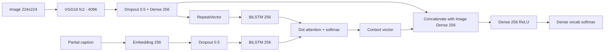

# Image Caption Generator

Generates natural-language captions for images. It uses a VGG16 encoder for image features and a Bidirectional LSTM decoder with a dot-product attention mechanism. It is trained on the Flickr8k dataset.

## Overview

1. **Image features:** VGG16 (ImageNet weights, final classification layer removed) turns each 224x224 image into a 4096-dimensional vector.
2. **Caption preprocessing:** Captions are lowercased and stripped of non-alphabetic characters and single-letter words. They are wrapped in `startseq` / `endseq` tokens and tokenized with the Keras `Tokenizer`.
3. **Captioning model:** The image vector and the partial caption are encoded separately. Attention combines them, and a softmax layer predicts the next word.
4. **Inference:** The caption is generated word by word (greedy decoding) until `endseq` or the maximum length.

## Model Architecture



## Dataset

[Flickr8k](https://www.kaggle.com/datasets/adityajn105/flickr8k): 8,091 images with 5 captions each (40,455 captions).

| Item | Value |
|---|---|
| Vocabulary size | 8,768 |
| Max caption length | 34 |
| Train / test split | 90% / 10% |

## Training

| Setting | Value |
|---|---|
| Loss | Categorical cross-entropy |
| Optimizer | Adam |
| Epochs | 50 |
| Batch size | 32 |
| Framework | TensorFlow / Keras |

## Results

Evaluated on the test split (810 images):

| Metric | Score |
|---|---|
| BLEU-1 | 0.425 |
| BLEU-2 | 0.195 |

Validation loss rises after the first few epochs while training loss keeps falling, which indicates overfitting. Early stopping, checkpointing the best epoch, or a lower epoch count would likely improve results.

## Repository Structure

```
Image Captioning.ipynb            # Notebook
image_caption_generator.ipynb     # Main notebook: features, training, evaluation, inference
model architecture/
  Image Caption.ipynb
  model_19.h5                     # Saved model weights
```

## Setup

The notebooks were written for Google Colab (GPU) with the dataset on Google Drive.

```bash
pip install tensorflow keras numpy matplotlib pillow nltk tqdm
```

Update the paths at the top of the notebook to match your environment:

```python
INPUT_DIR  = '/content/drive/MyDrive/flickr8k/flickr8K'          # contains Images/ and captions.txt
OUTPUT_DIR = '/content/drive/MyDrive/flickr8k/flickr8K/working'  # features, tokenizer, model
```

## Usage

1. Download Flickr8k and place `Images/` and `captions.txt` in `INPUT_DIR`.
2. Run `image_caption_generator.ipynb` top to bottom. It extracts VGG16 features, trains the model, saves it, and reports BLEU scores.
3. Generate a caption for an image:

```python
generate_caption("1077546505_a4f6c4daa9.jpg")
```

This prints the 5 reference captions, the predicted caption, and shows the image.

## Tech Stack

Python, TensorFlow/Keras, VGG16, LSTM with attention, NLTK (BLEU), NumPy, Matplotlib, Pillow

## Future Improvements

- Beam search decoding instead of greedy
- Early stopping and learning-rate scheduling
- Spatial (7x7x512) CNN features for true visual attention
- Pretrained word embeddings (GloVe)
- A Streamlit or Gradio demo app

## License

Add a license of your choice.
